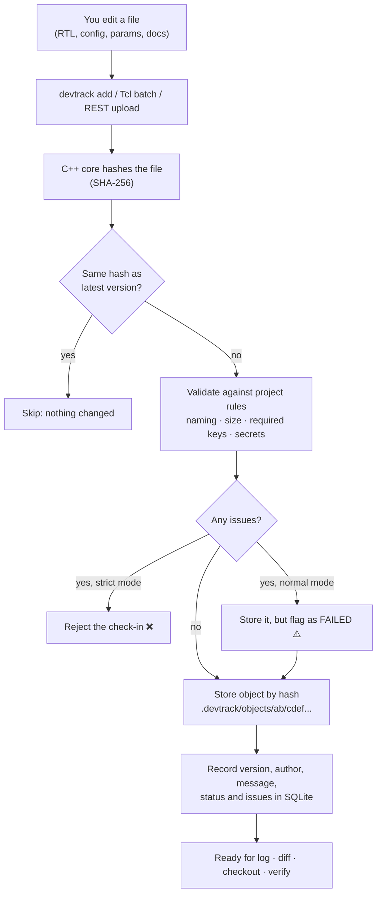
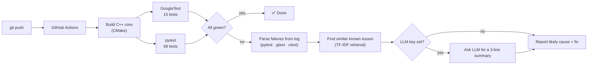
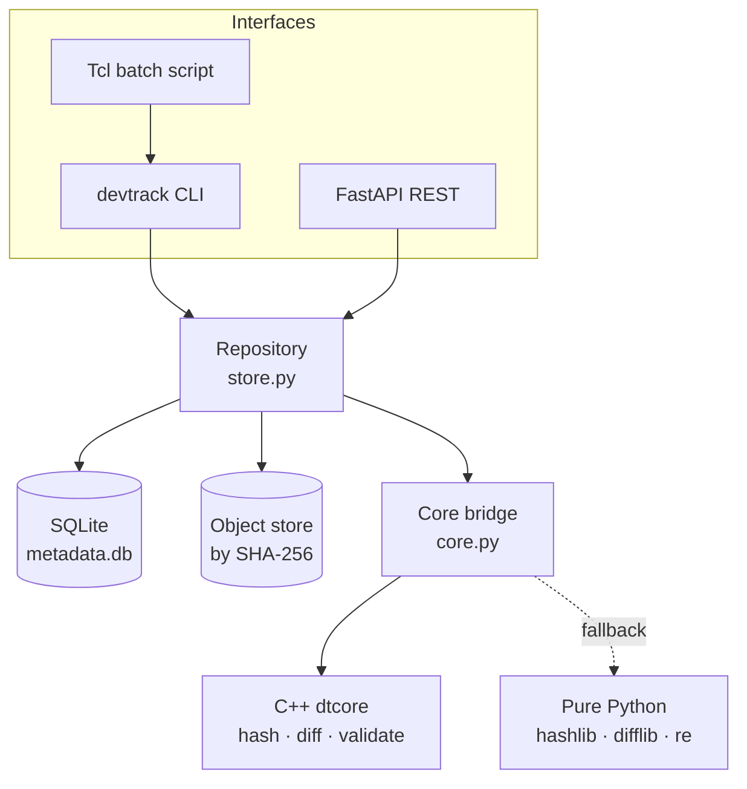

# DevTrack 🗂️

**Version control, validation and test triage for engineering files, built from scratch to learn how design-data management really works.**


---

## Why I built this

Whenever a build breaks on an engineering team, the same three questions come up:

1. *Who changed this file, and what did it look like before?*
2. *Was this file even valid when it was checked in?*
3. *The regression failed. Is it a new bug or something we've seen before?*

Git answers the first one well for source code. Chip-design and hardware teams, though, deal with config files, parameter sheets, RTL and generated data, and they need extra guard rails on top of plain version control. Whole commercial platforms exist just for this kind of design-data management. I wanted to understand the core ideas by building a small version myself: content-addressed storage, check-in validation, revision diffs, and a regression loop that helps you debug instead of just printing red text.

DevTrack is that experiment. It's small enough to read in an afternoon, but it's tested properly (80+ tests across C++ and Python) and runs in CI.

---

## How it works

### Checking in a file



### When a regression fails



### The pieces



---

## What it can do

| Feature | In plain words |
|---|---|
| **Content-addressed storage** | Every file is saved under its SHA-256 hash. Same content means it's stored once, and if anything gets corrupted, `devtrack verify` catches it. |
| **Version history** | Each check-in records who, when, why, and whether it passed validation. |
| **Diff any two versions** | Line-by-line diff, written in C++ using the longest-common-subsequence algorithm. |
| **Check-in rules** | Catch bad file names, oversized files, configs missing `name`/`version`, or a password someone pasted in by accident. |
| **C++ + Python** | The heavy lifting is in C++17. A Python fallback means it still runs without a compiler, and tests make sure both give identical answers. |
| **REST API** | Upload, browse history, diff, dry-run validation, all from `localhost:8000/docs`. |
| **Tcl automation** | EDA tools are usually scripted in Tcl, so there's a Tcl script that checks in a whole folder in one go. |
| **Failure triage** | When tests fail, DevTrack tells you which known issue it most likely is and what to try first. |

---

## Try it in 2 minutes

```bash
# build the C++ core (optional: Python falls back without it)
cmake -S . -B build && cmake --build build -j
ctest --test-dir build

# install
pip install -e ".[dev]"

# play with it
mkdir demo && cd demo
devtrack init
cp -r ../examples/artifacts .

devtrack add artifacts/alu_config.json -m "first ALU config"
sed -i 's/"width": 32/"width": 64/' artifacts/alu_config.json
devtrack add artifacts/alu_config.json -m "widen the ALU"

devtrack diff artifacts/alu_config.json 1
# -  "width": 32,
# +  "width": 64,

devtrack log artifacts/alu_config.json
devtrack checkout artifacts/alu_config.json 1   # go back in time
devtrack verify                                 # is the store healthy?
```

### Check in a whole folder from Tcl

```bash
tclsh ../scripts/devtrack_batch.tcl artifacts "initial import"
```
```
ok   artifacts/alu_config.json -> v1
WARN artifacts/Legacy-Board.json -> v1
     name_pattern: file name 'Legacy-Board.json' does not match ...
     forbid:3: forbidden text 'password='
summary: 3 stored, 0 unchanged, 1 with warnings, 0 rejected
```
*(`Legacy-Board.json` is broken on purpose, so you can see validation in action.)*

### REST API

```bash
devtrack serve   # then open http://127.0.0.1:8000/docs
curl -F path=rtl/top.v -F message="first" -F file=@top.v localhost:8000/artifacts
curl "localhost:8000/artifacts/rtl/top.v/diff?old=1"
```

| Method | Endpoint | What it does |
|---|---|---|
| GET | `/health` | Is it up, and is the C++ core in use? |
| GET | `/artifacts` | Everything tracked, with latest version |
| POST | `/artifacts` | Upload a new version |
| GET | `/artifacts/{path}/versions` | Full history |
| GET | `/artifacts/{path}/versions/{n}/content` | Download a specific version |
| GET | `/artifacts/{path}/diff?old=&new=` | Diff two versions |
| POST | `/validate` | Check a file without saving it |
| POST | `/triage` | Paste a failing log, get likely causes |
| GET | `/verify` | Integrity check |

### When tests fail

```bash
./scripts/run_regression.sh
```
```
✗ tests/test_alu.py::test_overflow  (AssertionError: expected 255 but got 0)
   likely: Numeric tolerance / assertion mismatch [KI-004]
   fix:    Diff the inputs between the last passing and first failing version ...
```

Triage works fully offline. If you want an LLM to add a short summary, set an API key for any OpenAI-compatible endpoint:

```bash
export DEVTRACK_LLM_API_KEY=...
export DEVTRACK_LLM_URL=https://api.openai.com/v1/chat/completions   # optional
export DEVTRACK_LLM_MODEL=gpt-4o-mini                                # optional
```

The knowledge base lives in `rules/known_issues.json`. Every time you fix a weird failure, add it there and triage gets smarter.

---

## Where this kind of tool fits

DevTrack is a learning project, not a product, but the ideas behind it are used in real engineering workflows:

| Where | How the ideas apply | Learn more |
|---|---|---|
| **Chip / IC design teams** | Versioning RTL, constraints and IP configs, with check-in rules before tapeout | [Product data management (overview)](https://en.wikipedia.org/wiki/Product_data_management) |
| **Open-source chip flows** | Tracking the Tcl scripts, configs and reports an RTL-to-GDS flow produces | [OpenROAD-flow-scripts](https://github.com/The-OpenROAD-Project/OpenROAD-flow-scripts) |
| **Hardware verification** | Running regressions on every change and triaging what failed | [cocotb](https://www.cocotb.org/) |
| **ML / data projects** | Versioning datasets and model files by content hash, same idea as DevTrack's object store | [DVC](https://dvc.org/) |
| **Large binary files in Git** | Storing big files outside the main repo, referenced by hash | [Git LFS](https://git-lfs.com/) |
| **Any CI pipeline** | Build → test → report on every push | [GitHub Actions docs](https://docs.github.com/en/actions) |

---

## Validation rules

`devtrack init` copies `rules/default.rules` into your project. Change it to suit your team:

```ini
name_pattern=^[a-z0-9_]+(\.[a-z0-9]+)+$
max_size_kb=2048
required_keys.json=name,version
forbid=password=
no_trailing_whitespace=true
```

---

## Tests

| Suite | Count | What it covers |
|---|---|---|
| GoogleTest | 15 | SHA-256 against official NIST test vectors (including a 1-million-character input), diff edge cases, every validation rule |
| pytest | 68 | Storage, CLI end to end, REST API (including path-traversal attempts), triage, and **C++ vs Python giving identical results** |

```bash
./scripts/run_regression.sh   # runs everything
```

---

## Project layout

```
core/       C++17: sha256, diff, validate, dtcore CLI, GoogleTest
devtrack/   Python: core bridge, store, CLI, REST API, triage
rules/      default validation rules + known-issues knowledge base
scripts/    run_regression.sh (Bash) and devtrack_batch.tcl (Tcl)
examples/   sample files (one broken on purpose)
tests/      pytest suite
```

---

## Things I learned / trade-offs I made

- **Content addressing is underrated.** Naming files by their hash gives you deduplication *and* corruption detection for free. It's the same trick Git uses internally.
- **Two implementations keep you honest.** Writing the core in both C++ and Python, then testing that they agree, forces you to pin down edge cases like CRLF line endings, missing trailing newlines and NUL bytes.
- **Retrieval before generation.** Triage first finds similar known issues and only then (optionally) asks an LLM. The answers stay grounded, and it works without internet.
- **Known limits:** the LCS diff uses O(n·m) memory, which is fine for source and config files but not for huge binaries. SQLite assumes one writer at a time. Both would be the first things to change if this grew up.

## What I'd add next

- A `devtrack tag` / release command to snapshot a set of versions together
- Binary-aware diff (e.g. summarising changes in large generated files)
- A tiny web dashboard on top of the REST API

---

*Built by [Avani Singh](https://www.linkedin.com/in/avani-singh-498a3b258). Feedback and issues welcome.*

MIT License
